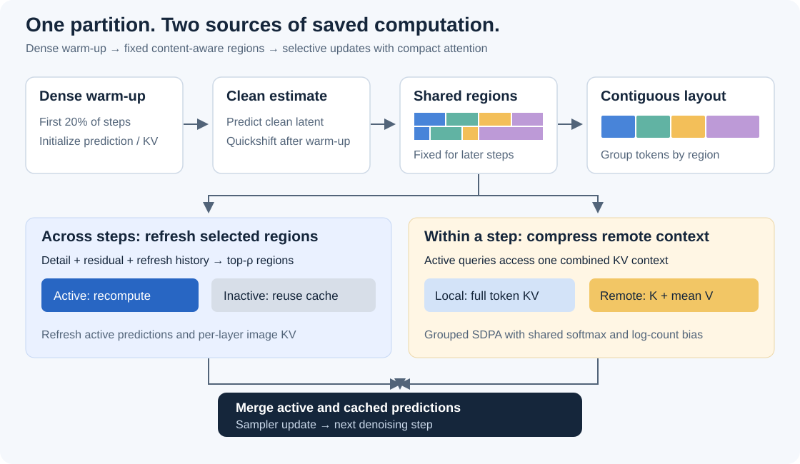

# SDiT: Region-Adaptive Sparse Inference for Diffusion Transformers

[Manuscript](https://github.com/linbowen0719-beep/ICLR-2027-SDiT) ·
[Quickstart](#installation) · [Measured results](#example-benchmark) ·
[Method](#how-it-works) · [Citation](#citation)

**Training-free acceleration through one shared region partition.** SDiT
updates selected image regions across denoising steps, keeps full local
attention, and summarizes remote regions into compact anchors. This repository
supports **Lumina-Next** and **HunyuanDiT**.

## Visual comparison

**“Peacock in a sunlit garden”** — Lumina-Next, seed 42, 30 steps, 1024×1024.

<table>
<tr><th>Dense</th><th>SDiT · ρ = 0.4</th><th>SDiT · ρ = 0.2</th></tr>
<tr>
<td width="33%"></td>
<td width="33%"></td>
<td width="33%"></td>
</tr>
<tr><td align="center">17.50 s · 1.00×</td><td align="center">8.09 s · 2.16×</td><td align="center">6.27 s · 2.79×</td></tr>
</table>

Images are the original generated PNGs. Times average two warmed runs of this
prompt on the same RTX 6000 Ada. Lower ρ refreshes fewer regions; compare both
settings to choose the quality–latency trade-off for your prompts.

## Example benchmark

Measured on **one RTX 6000 Ada (48 GB)** using the
[two fixed prompts and seeds](examples/prompts.jsonl) shipped with this repo.
All methods use 30 steps, 1024×1024, guidance 4 and BF16. Each prompt has one
excluded warm-up and two timed repeats. Quality metrics average the two paired
images against dense inference; LPIPS uses AlexNet.

| Method | Time ↓ | Speedup ↑ | PSNR ↑ | SSIM ↑ | LPIPS ↓ | Peak allocation |
|---|---:|---:|---:|---:|---:|---:|
| Dense | 18.09 s | 1.00× | — | — | — | 10.40 GiB |
| SDiT · ρ=0.4 | 7.70 s | 2.35× | 25.34 dB | 0.737 | 0.227 | 10.82 GiB |
| SDiT · ρ=0.2 | 5.90 s | 3.07× | 23.31 dB | 0.650 | 0.387 | 10.82 GiB |

Peak allocation is measured by PyTorch. [Per-run times, image hashes, versions
and metrics](docs/readme_benchmark.json) accompany this table.
These are current-release example measurements; the paper's dataset-scale
results use its historical experimental configuration.

Reproduce this table after installing the quality-evaluation dependencies:

```bash
CUDA_VISIBLE_DEVICES=0 python scripts/benchmark_examples.py --output outputs/readme
```

The script runs all variants sequentially, checks that timed and evaluated
images match, and writes `measurements.json`. Add `--model-path /path/to/model
--local-files-only` to use a local checkpoint.

## How it works



After a dense warm-up, Quickshift partitions the predicted clean latent once.
A detail/residual score and refresh history select active regions. Their queries
attend to full local KV and remote summaries; inactive regions reuse cached
predictions and KV. Region-contiguous storage supports grouped SDPA execution.

Defaults follow the manuscript: 20% warm-up, `h=1`, `m=1`, equal detail/residual
weights, and starvation coefficient 0.1. [Implementation details](docs/implementation.md)
map the equations to code and specify scheduling, boundaries and anchor groups.

## Installation

Use Linux, Python 3.10 or 3.11, and an NVIDIA CUDA GPU.

```bash
git clone https://github.com/linbowen0719-beep/SDiT.git
cd SDiT
python -m venv .venv
source .venv/bin/activate
python -m pip install --upgrade pip
python -m pip install torch==2.6.0 torchvision==0.21.0 --index-url https://download.pytorch.org/whl/cu124
python -m pip install -e .
sdit doctor
```

Install optional tools according to your task:

```bash
# Quality evaluation, including LPIPS and FID
python -m pip install -e '.[metrics]'

# Development and tests
python -m pip install -e '.[dev]'
```

Diffusers 0.35.1 and Transformers 4.56.0 are pinned to match the model adapters.
The release uses PyTorch SDPA and Triton helpers; no separate attention
extension needs to be built.

### Models and GPU memory

| Model | Hugging Face checkpoint | Precision / guidance |
|---|---|---|
| Lumina-Next | [`Alpha-VLLM/Lumina-Next-SFT-diffusers`](https://huggingface.co/Alpha-VLLM/Lumina-Next-SFT-diffusers) | BF16 / 4 |
| HunyuanDiT | [`Tencent-Hunyuan/HunyuanDiT-v1.2-Diffusers`](https://huggingface.co/Tencent-Hunyuan/HunyuanDiT-v1.2-Diffusers) | FP16 / 5 |

The runner downloads the matching checkpoint on first use. For an existing
Diffusers snapshot, pass `--model-path /path/to/model --local-files-only`.
Weights are distributed by the model providers under their respective licenses.

At batch size 1 and 1024×1024, this release measured **10.82 GiB** peak
PyTorch allocation for Lumina SDiT in the example benchmark and **11.33 GiB**
for the [Hunyuan ρ=0.2 validation run](docs/validation.json). GPU capacity also
needs headroom for CUDA contexts, reserved memory and workspaces. The tested
card has 48 GB; a minimum capacity and 24 GB RTX 3090/4090 compatibility have
not yet been established. CPU inference and CPU offload are not implemented.

## Generate an image

```bash
CUDA_VISIBLE_DEVICES=0 sdit generate \
  --config configs/lumina_sdit_r20.json \
  --prompt 'Peacock in a sunlit garden' --seed 42 \
  --output outputs/peacock
```

Use `configs/lumina_sdit_r40.json` for more active regions. Hunyuan configurations
are `configs/hunyuan_sdit_r20.json` and `configs/hunyuan_sdit_r40.json`.
`--rho`, `--steps`, `--anchors` and `--hops` override the chosen configuration.

For paired dense and SDiT generations:

```bash
sdit generate --config configs/lumina_sdit_r20.json --method dense \
  --prompts examples/prompts.jsonl --output outputs/dense
sdit generate --config configs/lumina_sdit_r20.json \
  --prompts examples/prompts.jsonl --output outputs/sdit
```

Each JSONL record specifies `id`, `prompt`, and `seed`; `negative_prompt` is
optional. Run directories contain PNGs, settings, package versions, source
hashes, timing records and `engine.log`. Choose a new or empty output directory.
`--dry-run` checks inputs without loading weights.

## Benchmark your prompts

```bash
sdit benchmark --config configs/lumina_sdit_r20.json \
  --prompt 'Peacock in a sunlit garden' --seed 42 \
  --warmup-runs 1 --repeats 2 --output outputs/benchmark
```

Timing uses CUDA synchronization around the pipeline call, including text
encoding, denoising, VAE decoding and PIL conversion. Model loading, request
reset and file writing are outside the interval. Each repeat resets the seed
and inference caches. Compare methods on the same idle GPU with matching inputs.

Available comparisons are `--method dense`, `--method temporal` (full image KV
with selective query updates), `--method ras` (Lumina), and `--method teacache`.
For density and module diagnostics, use `sdit generate --analysis` separately.
See [execution details](docs/backends.md).

## Quality evaluation

```bash
sdit evaluate --generated outputs/sdit --dense outputs/dense \
  --lpips --output outputs/quality.json
```

PSNR and SSIM work with the base installation; `--lpips` uses the metrics extra.
Metric weights download on first use. The evaluator checks matching prompts,
seeds, model settings and saved-image hashes. The previous `sdit-evaluate` command remains an alias.

For dataset-scale evaluation, add `--fid` to compute **FID_d** against the dense
image set, and `--real /path/to/real-images` for **FID_r** against real images.
Use the full evaluation set for FID; the two-image example reports paired
metrics. See [metric definitions and commands](docs/evaluation.md).

## Repository layout

| Directory | Contents |
|---|---|
| `src/sdit/` | Public CLI, configuration, manuscript policy and evaluation |
| `src/ras/` | Scheduling, attention, caches and model adapters |
| `configs/` | Explicit Lumina and Hunyuan settings |
| `examples/` | Prompt/seed manifest used in the example benchmark |
| `assets/` | Original comparison images and method diagram |
| `scripts/` | Example benchmark driver and release-content audit |
| `tests/` | Numerical, cache, scheduling and CLI tests |
| `docs/` | Implementation guide, metrics and measurement records |

```bash
python -m pytest -q
python -m build
python scripts/check_release.py
```

## Known limitations

- Low active-region ratios can lose texture or structure. Hunyuan `ρ=0.2`
  produces visible texture artifacts on the peacock validation prompt; its
  current presets remain experimental. See [validation](docs/validation.md).
- Small text, fine interactions across regions and very short sampling schedules
  can need more active computation or richer remote summaries.
- The current release implements the manuscript's reference policy. The original
  experimental snapshot used different settings for several policy details;
  the new measurements above describe this release. See
  [policy provenance](docs/implementation.md#release-provenance).
- Use one worker process per GPU: the inherited manager holds process-global
  state. This release supports image inference, with video left for future work.

## Citation

If you use SDiT, please cite the manuscript and link to this implementation:

```bibtex
@misc{lin2026sdit,
  title  = {{SDiT}: Region-Adaptive Sparse Inference for Diffusion Transformers},
  author = {Bowen Lin and Fanjiang Ye and Yihua Liu and Zhenghui Guo and
            Boyuan Zhang and Weijian Zheng and Yufan Xu and Tiancheng Xing and
            Yuke Wang and Chengming Zhang},
  year   = {2026},
  url    = {https://github.com/linbowen0719-beep/SDiT},
  note   = {Manuscript and source code}
}
```

## Attribution and license

SDiT's original code and release tools use the **[MIT License](LICENSE)**.
The implementation builds on [Microsoft RAS](https://github.com/microsoft/RAS)
(MIT) and [Hugging Face Diffusers](https://github.com/huggingface/diffusers);
files adapted from Diffusers retain their Apache-2.0 notices. See [NOTICE](NOTICE)
and [third-party licenses](licenses). Model weights and datasets retain their
providers' licenses.
