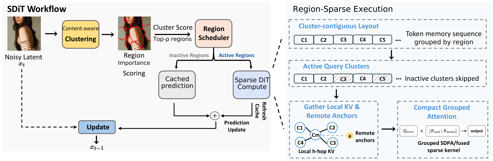

# SDiT: Region-Adaptive Sparse Inference for Diffusion Transformers

[Manuscript](https://github.com/linbowen0719-beep/ICLR-2027-SDiT) ·
[Quickstart](#installation) · [Paper results](#paper-results) ·
[Method](#how-it-works) · [Citation](#citation)

**Training-free acceleration through one shared region partition.** SDiT
updates selected image regions across denoising steps, keeps full local
attention, and summarizes remote regions into compact anchors. This repository
supports **Lumina-Next** and **HunyuanDiT**.

## Visual comparison


Figure 1 from the paper: Lumina-Next at 30 steps and 1024×1024.
SDiT preserves fine geometric patterns at **6.49 s (3.65× speedup)**.

## Paper results

Results reported in **Table 1 of the paper**, evaluated on **5,000 MS-COCO
prompts at 30 steps and 1024×1024**. FID_d compares against dense generations;
FID_r compares against real COCO images. Control is each method's setting
(the active-region ratio ρ for SDiT). Bold marks the best accelerated result
per metric within each backbone.

### Lumina-Next

| Method | Control | Time (s) ↓ | Speedup ↑ | FID_d ↓ | FID_r ↓ | PSNR (dB) ↑ |
|---|---:|---:|---:|---:|---:|---:|
| Dense | 1.00 | 23.72 | 1.00× | — | 29.63 | — |
| SDiT | 0.60 | 10.74 | 2.21× | 6.93 | **30.07** | 24.06 |
| SDiT | 0.40 | 8.70 | 2.73× | **6.66** | 30.71 | **24.30** |
| SDiT | 0.20 | 6.49 | 3.65× | 9.13 | 32.12 | 23.53 |
| SDiT | 0.10 | **5.89** | **4.03**× | 22.03 | 39.73 | 22.36 |
| RAS | 0.50 | 13.92 | 1.70× | 11.74 | 32.67 | 22.57 |
| RAS | 0.25 | 10.31 | 2.30× | 20.82 | 39.25 | 21.23 |
| TeaCache | 0.30 | 8.74 | 2.71× | 8.20 | 33.33 | 24.04 |
| TeaCache | 0.20 | 6.55 | 3.62× | 15.31 | 37.97 | 20.75 |

<details>
<summary><strong>HunyuanDiT results</strong></summary>

| Method | Control | Time (s) ↓ | Speedup ↑ | FID_d ↓ | FID_r ↓ | PSNR (dB) ↑ |
|---|---:|---:|---:|---:|---:|---:|
| Dense | 1.00 | 11.96 | 1.00× | — | 34.86 | — |
| SDiT | 0.50 | 6.82 | 1.75× | **12.74** | 29.48 | 15.06 |
| SDiT | 0.40 | 5.84 | 2.05× | 17.74 | **29.24** | 14.13 |
| SDiT | 0.30 | 4.79 | 2.50× | 29.19 | 32.49 | 13.30 |
| SDiT | 0.20 | **4.00** | **2.99**× | 66.83 | 58.10 | 12.20 |
| RAS | 0.40 | 12.56 | 0.95× | 44.86 | 42.21 | 12.74 |
| RAS | 0.30 | 11.27 | 1.06× | 74.36 | 65.29 | 12.08 |
| TeaCache | 0.75 | 5.63 | 2.13× | 41.79 | 39.54 | **15.13** |
| TeaCache | 1.00 | 4.89 | 2.45× | 72.17 | 62.18 | 14.68 |

</details>

[Full paper table](https://github.com/linbowen0719-beep/ICLR-2027-SDiT/blob/main/table/table_main_result.tex)
includes CLIP and MUSIQ. These are paper-reported results under the paper's
experimental configuration; see [implementation provenance](docs/implementation.md#release-provenance).

## How it works



The framework figure above is reproduced from the paper.

After a dense warm-up, Quickshift partitions the predicted clean latent once.
A detail/residual score and refresh history select active regions. Their queries
attend to full local KV and remote summaries; inactive regions reuse cached
predictions and KV. Region-contiguous storage supports grouped SDPA execution.

Defaults follow the manuscript: 20% warm-up, `h=1`, `m=1`, equal detail/residual
weights, and starvation coefficient 0.1. [Implementation details](docs/implementation.md)
map the equations to code and specify scheduling, boundaries and anchor groups.

## Installation

Use Linux, Python 3.10 or 3.11, and an NVIDIA CUDA GPU.

```bash
git clone https://github.com/linbowen0719-beep/SDiT.git
cd SDiT
python -m venv .venv
source .venv/bin/activate
python -m pip install --upgrade pip
python -m pip install torch==2.6.0 torchvision==0.21.0 --index-url https://download.pytorch.org/whl/cu124
python -m pip install -e .
sdit doctor
```

Install optional tools according to your task:

```bash
# Quality evaluation, including LPIPS and FID
python -m pip install -e '.[metrics]'

# Development and tests
python -m pip install -e '.[dev]'
```

Diffusers 0.35.1 and Transformers 4.56.0 are pinned to match the model adapters.
The release uses PyTorch SDPA and Triton helpers; no separate attention
extension needs to be built.

### Models and GPU memory

| Model | Hugging Face checkpoint | Precision / guidance |
|---|---|---|
| Lumina-Next | [`Alpha-VLLM/Lumina-Next-SFT-diffusers`](https://huggingface.co/Alpha-VLLM/Lumina-Next-SFT-diffusers) | BF16 / 4 |
| HunyuanDiT | [`Tencent-Hunyuan/HunyuanDiT-v1.2-Diffusers`](https://huggingface.co/Tencent-Hunyuan/HunyuanDiT-v1.2-Diffusers) | FP16 / 5 |

The runner downloads the matching checkpoint on first use. For an existing
Diffusers snapshot, pass `--model-path /path/to/model --local-files-only`.
Weights are distributed by the model providers under their respective licenses.

The tested GPU is an RTX 6000 Ada (48 GB). A minimum GPU capacity and
24 GB RTX 3090/4090 compatibility have not yet been established. CPU inference
and CPU offload are not implemented.

## Generate an image

```bash
CUDA_VISIBLE_DEVICES=0 sdit generate \
  --config configs/lumina_sdit_r20.json \
  --prompt 'Peacock in a sunlit garden' --seed 42 \
  --output outputs/peacock
```

Use `configs/lumina_sdit_r40.json` for more active regions. Hunyuan configurations
are `configs/hunyuan_sdit_r20.json` and `configs/hunyuan_sdit_r40.json`.
`--rho`, `--steps`, `--anchors` and `--hops` override the chosen configuration.

For paired dense and SDiT generations:

```bash
sdit generate --config configs/lumina_sdit_r20.json --method dense \
  --prompts examples/prompts.jsonl --output outputs/dense
sdit generate --config configs/lumina_sdit_r20.json \
  --prompts examples/prompts.jsonl --output outputs/sdit
```

Each JSONL record specifies `id`, `prompt`, and `seed`; `negative_prompt` is
optional. Run directories contain PNGs, settings, package versions, source
hashes, timing records and `engine.log`. Choose a new or empty output directory.
`--dry-run` checks inputs without loading weights.

## Benchmark your prompts

```bash
sdit benchmark --config configs/lumina_sdit_r20.json \
  --prompt 'Peacock in a sunlit garden' --seed 42 \
  --warmup-runs 1 --repeats 2 --output outputs/benchmark
```

Timing uses CUDA synchronization around the pipeline call, including text
encoding, denoising, VAE decoding and PIL conversion. Model loading, request
reset and file writing are outside the interval. Each repeat resets the seed
and inference caches. Compare methods on the same idle GPU with matching inputs.

Available comparisons are `--method dense`, `--method temporal` (full image KV
with selective query updates), `--method ras` (Lumina), and `--method teacache`.
For density and module diagnostics, use `sdit generate --analysis` separately.
See [execution details](docs/backends.md).

## Quality evaluation

```bash
sdit evaluate --generated outputs/sdit --dense outputs/dense \
  --lpips --output outputs/quality.json
```

PSNR and SSIM work with the base installation; `--lpips` uses the metrics extra.
Metric weights download on first use. The evaluator checks matching prompts,
seeds, model settings and saved-image hashes. The previous `sdit-evaluate` command remains an alias.

For dataset-scale evaluation, add `--fid` to compute **FID_d** against the dense
image set, and `--real /path/to/real-images` for **FID_r** against real images.
Use the full evaluation set for FID. See [metric definitions and commands](docs/evaluation.md).

## Repository layout

| Directory | Contents |
|---|---|
| `src/sdit/` | Public CLI, configuration, manuscript policy and evaluation |
| `src/ras/` | Scheduling, attention, caches and model adapters |
| `configs/` | Explicit Lumina and Hunyuan settings |
| `examples/` | Sample prompts and seeds for generation |
| `assets/` | Comparison and framework figures from the paper |
| `scripts/` | Example benchmark driver and release-content audit |
| `tests/` | Numerical, cache, scheduling and CLI tests |
| `docs/` | Implementation guide, metrics and measurement records |

```bash
python -m pytest -q
python -m build
python scripts/check_release.py
```

## Known limitations

- Low active-region ratios can lose texture or structure. Hunyuan `ρ=0.2`
  produces visible texture artifacts on the peacock validation prompt; its
  current presets remain experimental. See [validation](docs/validation.md).
- Small text, fine interactions across regions and very short sampling schedules
  can need more active computation or richer remote summaries.
- The current release implements the manuscript's reference policy. The original
  experimental snapshot used different settings for several policy details;
  see
  [policy provenance](docs/implementation.md#release-provenance).
- Use one worker process per GPU: the inherited manager holds process-global
  state. This release supports image inference, with video left for future work.

## Citation

If you use SDiT, please cite the manuscript and link to this implementation:

```bibtex
@misc{lin2026sdit,
  title  = {{SDiT}: Region-Adaptive Sparse Inference for Diffusion Transformers},
  author = {Bowen Lin and Fanjiang Ye and Yihua Liu and Zhenghui Guo and
            Boyuan Zhang and Weijian Zheng and Yufan Xu and Tiancheng Xing and
            Yuke Wang and Chengming Zhang},
  year   = {2026},
  url    = {https://github.com/linbowen0719-beep/SDiT},
  note   = {Manuscript and source code}
}
```

## Attribution and license

SDiT's original code and release tools use the **[MIT License](LICENSE)**.
The implementation builds on [Microsoft RAS](https://github.com/microsoft/RAS)
(MIT) and [Hugging Face Diffusers](https://github.com/huggingface/diffusers);
files adapted from Diffusers retain their Apache-2.0 notices. See [NOTICE](NOTICE)
and [third-party licenses](licenses). Model weights and datasets retain their
providers' licenses.
