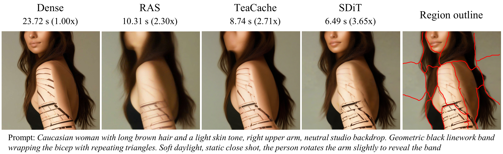

# SDiT: Region-Adaptive Sparse Inference for Diffusion Transformers

[Paper](https://github.com/linbowen0719-beep/ICLR-2027-SDiT) ·
[Quickstart](#installation) · [Results](#results) ·
[Method](#how-it-works) · [Citation](#citation)

**SDiT makes diffusion transformers up to 4× faster with no training.** It
partitions the image into regions once, then uses that single partition for two
things: deciding which regions to recompute at each denoising step, and
structuring attention so every region keeps full local context while seeing
distant regions through compact anchors.

On Lumina-Next at 1024×1024, SDiT reaches a **3.65× speedup** with FID_r 32.12,
against 37.97 for TeaCache at the same speed. This repository supports
**Lumina-Next** and **HunyuanDiT**.

## Visual comparison



Lumina-Next, 30 steps, 1024×1024. At **6.49 s (3.65×)**, SDiT keeps the fine
geometric patterns that the other accelerated methods lose.

## Results

5,000 MS-COCO prompts, 30 steps, 1024×1024. FID_d is measured against dense
generations and FID_r against real COCO images. *Control* is each method's
speed setting (for SDiT, the active-region ratio ρ). Bold marks the best
accelerated result per metric.

### Lumina-Next

| Method | Control | Time (s) ↓ | Speedup ↑ | FID_d ↓ | FID_r ↓ | PSNR (dB) ↑ |
|---|---:|---:|---:|---:|---:|---:|
| Dense | 1.00 | 23.72 | 1.00× | — | 29.63 | — |
| SDiT | 0.60 | 10.74 | 2.21× | 6.93 | **30.07** | 24.06 |
| SDiT | 0.40 | 8.70 | 2.73× | **6.66** | 30.71 | **24.30** |
| SDiT | 0.20 | 6.49 | 3.65× | 9.13 | 32.12 | 23.53 |
| SDiT | 0.10 | **5.89** | **4.03**× | 22.03 | 39.73 | 22.36 |
| RAS | 0.50 | 13.92 | 1.70× | 11.74 | 32.67 | 22.57 |
| RAS | 0.25 | 10.31 | 2.30× | 20.82 | 39.25 | 21.23 |
| TeaCache | 0.30 | 8.74 | 2.71× | 8.20 | 33.33 | 24.04 |
| TeaCache | 0.20 | 6.55 | 3.62× | 15.31 | 37.97 | 20.75 |

At matched speed, SDiT beats TeaCache on every metric: at ~2.7× (FID_d 6.66 vs
8.20) and at ~3.6× (FID_d 9.13 vs 15.31).

<details>
<summary><strong>HunyuanDiT</strong></summary>

| Method | Control | Time (s) ↓ | Speedup ↑ | FID_d ↓ | FID_r ↓ | PSNR (dB) ↑ |
|---|---:|---:|---:|---:|---:|---:|
| Dense | 1.00 | 11.96 | 1.00× | — | 34.86 | — |
| SDiT | 0.50 | 6.82 | 1.75× | **12.74** | 29.48 | 15.06 |
| SDiT | 0.40 | 5.84 | 2.05× | 17.74 | **29.24** | 14.13 |
| SDiT | 0.30 | 4.79 | 2.50× | 29.19 | 32.49 | 13.30 |
| SDiT | 0.20 | **4.00** | **2.99**× | 66.83 | 58.10 | 12.20 |
| RAS | 0.40 | 12.56 | 0.95× | 44.86 | 42.21 | 12.74 |
| RAS | 0.30 | 11.27 | 1.06× | 74.36 | 65.29 | 12.08 |
| TeaCache | 0.75 | 5.63 | 2.13× | 41.79 | 39.54 | **15.13** |
| TeaCache | 1.00 | 4.89 | 2.45× | 72.17 | 62.18 | 14.68 |

</details>

The [full table](https://github.com/linbowen0719-beep/ICLR-2027-SDiT/blob/main/table/table_main_result.tex)
adds CLIP and MUSIQ. For how this release relates to the paper's experimental
code, see [release provenance](docs/implementation.md#release-provenance).

## How it works


1. **Partition once.** After a short dense warm-up, Quickshift segments the
   predicted clean latent into regions.
2. **Pick what to update.** A detail/residual score, combined with each region's
   refresh history, selects the active regions for the step.
3. **Attend locally, summarize remotely.** Active queries attend to full KV
   within their region and to anchor summaries of every other region. Inactive
   regions reuse their cached predictions and KV.
4. **Run it fast.** Region-contiguous storage lets attention run as grouped SDPA.

Defaults match the paper: 20% warm-up, `h=1`, `m=1`, equal detail and residual
weights, and starvation coefficient 0.1. The [implementation guide](docs/implementation.md)
maps each equation to code and covers scheduling, boundaries and anchor groups.

## Installation

Requires Linux, Python 3.10 or 3.11, and an NVIDIA CUDA GPU.

```bash
git clone https://github.com/linbowen0719-beep/SDiT.git
cd SDiT
python -m venv .venv
source .venv/bin/activate
python -m pip install --upgrade pip
python -m pip install torch==2.6.0 torchvision==0.21.0 --index-url https://download.pytorch.org/whl/cu124
python -m pip install -e .
sdit doctor
```

Optional extras:

```bash
python -m pip install -e '.[metrics]'   # LPIPS and FID
python -m pip install -e '.[dev]'       # tests and development
```

Diffusers 0.35.1 and Transformers 4.56.0 are pinned to match the model adapters.
Attention runs on PyTorch SDPA and Triton, so there is no extension to compile.

### Models

| Model | Hugging Face checkpoint | Precision / guidance |
|---|---|---|
| Lumina-Next | [`Alpha-VLLM/Lumina-Next-SFT-diffusers`](https://huggingface.co/Alpha-VLLM/Lumina-Next-SFT-diffusers) | BF16 / 4 |
| HunyuanDiT | [`Tencent-Hunyuan/HunyuanDiT-v1.2-Diffusers`](https://huggingface.co/Tencent-Hunyuan/HunyuanDiT-v1.2-Diffusers) | FP16 / 5 |

Checkpoints download automatically on first run. To use a local Diffusers
snapshot, pass `--model-path /path/to/model --local-files-only`. Model weights
are subject to their providers' licenses.

All results were measured on an RTX 6000 Ada (48 GB). Smaller GPUs, such as
24 GB cards, are untested, and CPU inference is not supported.

## Generate an image

```bash
CUDA_VISIBLE_DEVICES=0 sdit generate \
  --config configs/lumina_sdit_r20.json \
  --prompt 'Peacock in a sunlit garden' --seed 42 \
  --output outputs/peacock
```

Presets: `configs/lumina_sdit_r20.json` and `lumina_sdit_r40.json` (higher
quality) for Lumina-Next; `hunyuan_sdit_r20.json` and `hunyuan_sdit_r40.json`
for HunyuanDiT. Override any preset with `--rho`, `--steps`, `--anchors` or `--hops`.

To generate dense and SDiT images side by side from a prompt file:

```bash
sdit generate --config configs/lumina_sdit_r20.json --method dense \
  --prompts examples/prompts.jsonl --output outputs/dense
sdit generate --config configs/lumina_sdit_r20.json \
  --prompts examples/prompts.jsonl --output outputs/sdit
```

Each JSONL line has `id`, `prompt` and `seed`, plus an optional `negative_prompt`.
Every run writes its images together with the settings, package versions, source
hashes, timings and an `engine.log`, so results can be traced back exactly.
Write each run to a fresh directory. Add `--dry-run` to validate inputs without
loading weights.

## Benchmark

```bash
sdit benchmark --config configs/lumina_sdit_r20.json \
  --prompt 'Peacock in a sunlit garden' --seed 42 \
  --warmup-runs 1 --repeats 2 --output outputs/benchmark
```

Reported time covers the full pipeline call (text encoding, denoising, VAE
decoding and PIL conversion) with CUDA synchronization; model loading and file
I/O are excluded. Seeds and caches reset between repeats.

Baselines: `--method dense`, `--method temporal` (selective query updates over
full image KV), `--method ras` (Lumina-Next only) and `--method teacache`. For
density and per-module diagnostics, use `sdit generate --analysis`. See
[execution details](docs/backends.md).

## Evaluate quality

```bash
sdit evaluate --generated outputs/sdit --dense outputs/dense \
  --lpips --output outputs/quality.json
```

PSNR and SSIM are built in; `--lpips` needs the `metrics` extra. The evaluator
verifies that prompts, seeds, model settings and image hashes match between the
two runs before scoring.

For dataset-scale evaluation, `--fid` computes **FID_d** against the dense set,
and `--real /path/to/real-images` adds **FID_r** against real images. See
[metrics and commands](docs/evaluation.md).

## Citation

```bibtex
@misc{lin2026sdit,
  title  = {{SDiT}: Region-Adaptive Sparse Inference for Diffusion Transformers},
  author = {Bowen Lin and Fanjiang Ye and Yihua Liu and Zhenghui Guo and
            Boyuan Zhang and Weijian Zheng and Yufan Xu and Tiancheng Xing and
            Yuke Wang and Chengming Zhang},
  year   = {2026},
  url    = {https://github.com/linbowen0719-beep/SDiT},
  note   = {Manuscript and source code}
}
```

## License

SDiT is released under the **[MIT License](LICENSE)**. It builds on
[Microsoft RAS](https://github.com/microsoft/RAS) (MIT) and
[Hugging Face Diffusers](https://github.com/huggingface/diffusers); files adapted
from Diffusers keep their Apache-2.0 notices. See [NOTICE](NOTICE) and
[third-party licenses](licenses). Model weights and datasets remain under their
providers' licenses.
